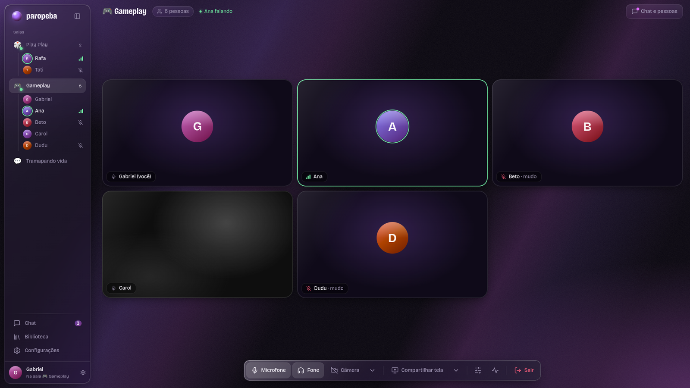
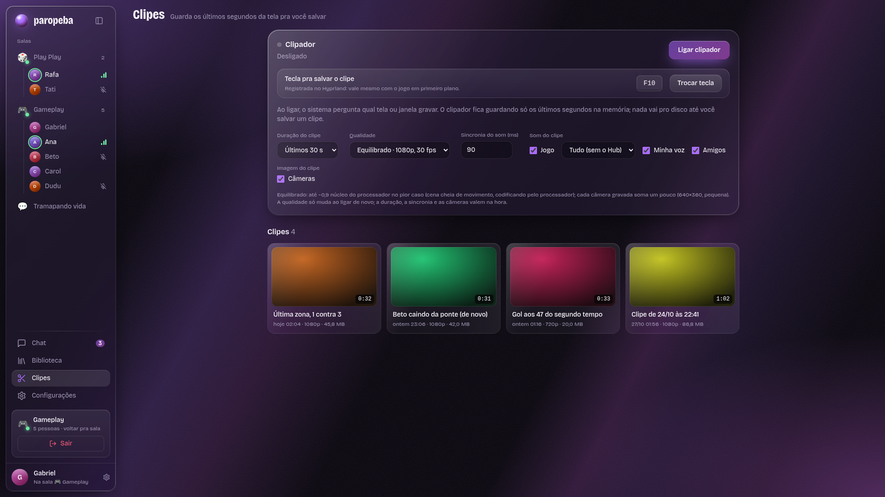

<div align="center">


# Paropeba Hub

**Salas de voz e tela, clipador e biblioteca de clipes do grupo, num app só.**

[](https://github.com/GabrielAguiarF/paropeba-hub-releases/releases/latest)
[](https://github.com/GabrielAguiarF/paropeba-hub-releases/releases)


[**Baixar a última versão**](https://github.com/GabrielAguiarF/paropeba-hub-releases/releases/latest)

<br>



<sub>Telas com dados de exemplo.</sub>

</div>

## O que é

O Hub reúne o que o grupo usa junto numa janela só e ganha módulos com o tempo. O app de PC abre o site do grupo
e acrescenta o que o navegador não consegue: som do sistema sem a call, atalhos globais e o clipador.

| | |
|---|---|
| **Salas de voz e tela** | Câmera, microfone e compartilhamento de tela com perfis de qualidade (Jogo, Texto e Leve), escolha automática de codec e painel de estatísticas pra ver o que está acontecendo de verdade. |
| **Voz limpa** | Supressor de ruído, ganho, volume por pessoa, escolha de microfone, câmera e saída de áudio, botão de fone e apertar-pra-falar global. |
| **Som do jogo sem a call** | Compartilha o som dos aplicativos que você escolher sem mandar a voz dos amigos junto. |
| **Clipador** | Guarda só na memória os últimos segundos da tela (com o som do jogo e as vozes). Um atalho salva o clipe em MP4, sem recodificar. |
| **Câmeras nos clipes** | A câmera de cada um é gravada junto. Depois, no player, você escolhe quem aparece, o canto e o tamanho e coloca no vídeo antes de compartilhar. |
| **Biblioteca do grupo** | Clipes, arquivos e links compartilhados, organizados em abas. |
| **Chat** | Chats do grupo com fotos e arquivos, histórico guardado, e dá pra vincular um chat a uma sala. |

<div align="center">

</div>

## Baixar

Na [página da última versão](https://github.com/GabrielAguiarF/paropeba-hub-releases/releases/latest), em **Assets**:

| Seu sistema | Arquivo |
|---|---|
| Windows 10 ou 11 | `hub_paropeba-v…_windows.exe` |
| Linux | `hub_paropeba-v…_linux.AppImage` |

Os outros arquivos da lista (`latest*.yml` e `.blockmap`) são do atualizador automático. Não precisa baixar.

### Windows

1. Abra o `.exe`. Ele instala só pro seu usuário, sem pedir administrador, e já abre o app.
2. O Windows pode avisar **"O Windows protegeu seu PC"**, porque o app ainda não tem assinatura digital.
   Clique em **Mais informações** e depois em **Executar assim mesmo**.

> A versão pra Windows é nova e ainda está em testes, principalmente a captura do som do sistema.

### Linux

```sh
chmod +x hub_paropeba-*_linux.AppImage
./hub_paropeba-*_linux.AppImage
```

- Se o AppImage não abrir reclamando de FUSE, instale o FUSE 2: `libfuse2` (Ubuntu/Debian), `fuse2` (Arch) ou `fuse-libs` (Fedora).
- **Dica:** renomeie o arquivo pra algo sem número de versão (por exemplo `paropeba-hub.AppImage`) e deixe numa pasta sua,
  como `~/Applications`. Assim a atualização troca o arquivo no mesmo lugar e o seu atalho continua funcionando.
- **Wayland:** nenhum aplicativo consegue ouvir teclas globais por lá, então o atalho vem do seu compositor. No Hyprland o app
  registra a tecla do clipe sozinho. Nos outros, ele mostra na tela o comando pronto pra você ligar à tecla que quiser.

## Atualizações

O app se atualiza sozinho. Ele confere se há versão nova ao abrir e a cada 4 horas, baixa em segundo plano e avisa.
**A instalação acontece quando você fecha o Hub**: ele nunca reinicia no meio de uma call ou de uma transmissão.

- As telas e a conversa vêm do site, então mudam sem você instalar nada.
- A v0.1 não tem atualização automática. Se você está nela, instale a versão mais recente por aqui uma vez, e dali em diante é automático.
- Pra desligar a checagem, abra o app com a variável `HUB_NO_UPDATE=1`.

## Problemas?

- **Os clipes** ficam na sua pasta de Vídeos, em `Paropeba Clips`.
- **O registro do atualizador** é o arquivo `updater.log`, em `~/.config/@paropeba/desktop/` no Linux e em
  `%APPDATA%\@paropeba\desktop\` no Windows. Se a atualização não chegou, ele diz por quê. Manda ele junto quando for pedir ajuda.
- O resto, fala no Discord do grupo.

## Sobre este repositório

Aqui ficam só os instaladores, na aba [Releases](https://github.com/GabrielAguiarF/paropeba-hub-releases/releases). O código-fonte
é privado e as versões são geradas e publicadas automaticamente a cada lançamento, então não há o que abrir pull request.
O app é de uso do grupo.
